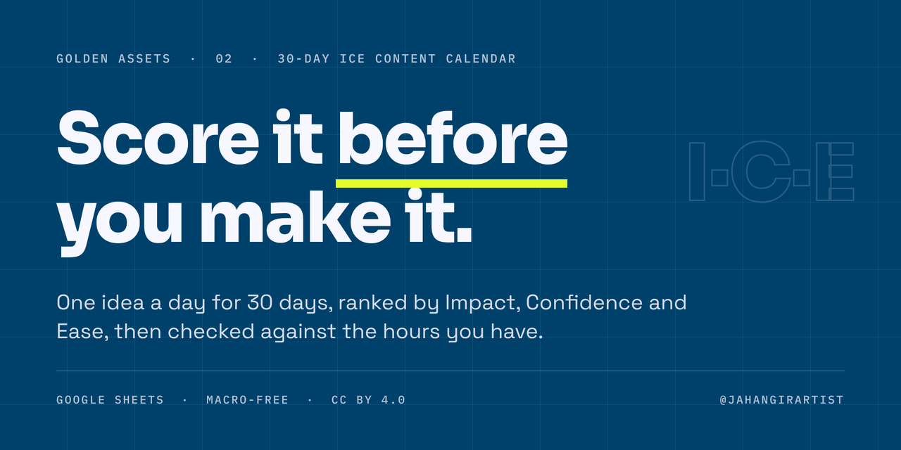

# Golden Assets: 30-Day ICE Content Calendar

**Score it before you make it.** A free content system for a one-person brand team: plan one idea a day for 30 days, score each idea with ICE before it takes production time, and check the plan against the hours you actually have.

**[Make a copy in Google Sheets →](https://docs.google.com/spreadsheets/d/1-8ys8FTiyvLQZh3eJrr6obiIRJcKt4aqzhQ-rllY-Fo/copy)** · [Download the .xlsx (v1.0)](https://github.com/jahangirartist/golden-assets-ice-content-calendar/releases/latest)

---

## Why it exists

Small brand teams rarely run out of ideas. They run out of time. A calendar that only lists dates fills every slot with whatever is easiest to make, and the posts that could bring orders or enquiries never get built.

This calendar moves the decision before production. Every idea is scored on Impact, Confidence and Ease, ranked and tiered, then checked against your weekly hours and your content mix before anything gets made.

## What it decides

- **Which ideas earn production time.** Each idea gets an ICE score, a rank and a tier: **A · Build first**, **B · Build** or **C · Park**.
- **Whether the plan fits your time.** Capacity compares planned minutes per week with the hours you have, and flags tight weeks.
- **Whether the mix is balanced.** Mix Check compares the plan with your targets for intent (Educate, Engage, Convert), format (Proven, Test, Experiment) and platform coverage.
- **Which lead magnets to build.** Free resources that turn followers into enquiries, scored the same way.

## The scoring decision: a geometric mean

Impact, Confidence and Ease are each scored from 1 to 10 using the [rubric](docs/ice-rubric.md). The calendar multiplies the three and takes the cube root:

**ICE score = ∛(Impact × Confidence × Ease)**

The score stays on the same 1 to 10 scale, but one weak score pulls the whole idea down, which a simple average hides. An idea scored 9, 9 and 2 averages 6.7, which would look worth building. Its ICE score here is 5.5, the bottom of tier B, because it needs time or budget you don't have.

The Golden Assets [Growth Tracker](https://github.com/jahangirartist/golden-assets-growth-tracker) adds the three scores in its experiment backlog instead. Experiments are cheap and the backlog is re-ranked weekly. Here production time is the scarce resource, so a single weak score should sink an idea.

## Tabs

| Tab | What it does |
|---|---|
| Read Me | Setup steps, your settings (start date, weekly hours, tier thresholds) and the colour key |
| Platform Playbook | The role, language, cadence, best time, link handling, KPI and effort for each platform. Fill this in first. |
| Weekly Rhythm | Which days each platform posts, checked against the Playbook cadence |
| Calendar | One idea a day for 30 days: topic, pillar, format, hook, CTA, platforms, ICE score, rank, tier and results |
| Distribution | One row per platform post. Date, topic and effort fill in from the other tabs. |
| Capacity | Planned minutes per week against the hours you have |
| Lead Magnets | Free resources that turn followers into enquiries, scored with ICE |
| ICE Rubric | How to score Impact, Confidence and Ease, with a live calculator |
| Mix Check | Whether the plan is balanced across intent, format and platform |

## Set up

1. **Settings.** On the Read Me tab, set your start date and weekly hours. Every date in the workbook follows the start date.
2. **Platforms.** Fill in the Platform Playbook with the platforms you actually use, then mark your posting days on Weekly Rhythm.
3. **Plan.** Add one idea per day on the Calendar tab and score each one with the ICE Rubric.
4. **Check.** List every platform post on the Distribution tab, then review Capacity and Mix Check before you start producing.
5. **Learn.** After publishing, log the results, and use them to score Confidence more honestly in the next cycle.

White cells are yours to fill in. Grey cells calculate on their own; typing over them breaks the formulas.

## Built to be checked

- 9 tabs, 461 formulas and zero errors in the released file. No macros.
- Built for Google Sheets. The .xlsx uses only standard spreadsheet functions, so it also opens in Excel.
- The examples belong to a fictional neighbourhood bakery, with 8 of the 30 days filled in. Clear the white cells to start your own plan.

## বাংলাদেশি ব্যবসার মালিকদের জন্য: ৩ ধাপে শুরু

১. উপরের **Make a copy** থেকে নিজের ফ্রি কপি নিন, Read Me ট্যাবে শুরুর তারিখ আর সপ্তাহে কত ঘণ্টা সময় আছে, তা বসান। 
২. প্রতিদিনের একটা আইডিয়া লিখে ICE স্কোর দিন: Impact, Confidence আর Ease, প্রতিটি ১ থেকে ১০। 
৩. A টিয়ারের আইডিয়া আগে বানান, আর Capacity ট্যাবে দেখে নিন পরিকল্পনা আপনার সময়ে আঁটে কি না।

নিজে সেট করার সময় না থাকলে লিখুন: jahangirartist.x@gmail.com

## Credits and licence

**Method credited:** ICE scoring to Sean Ellis. The geometric-mean variant, the workbook design and the sample plan are original.

**Licence:** [CC BY 4.0](LICENSE). Free to use, adapt and share, including commercially, as long as the credit stays with the workbook.

**No warranty:** provided as is.

---

Built by **[Jahangir Alam](https://github.com/jahangirartist)**, Brand & Communications Lead (MBA, Finance), Dhaka. Part of **Golden Assets**, free systems for businesses without a data team. See also the [Growth Tracker](https://github.com/jahangirartist/golden-assets-growth-tracker).
